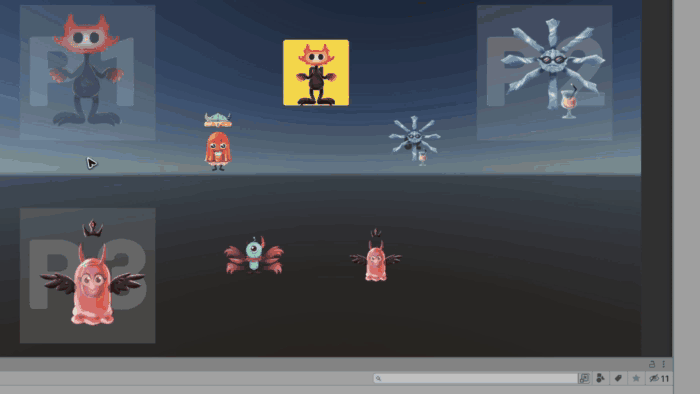

# Seaside Monster Cup

A local multiplayer kart racer starring monsters designed by children, made for the client Concordia. Saxion *Project Show-Off*, May–Jul 2023, 7-person team. I was the team's only programmer and wrote about 99% of the game scripts, about 5,800 lines.

 Development capture: character selection into four-player split screen

<!-- TODO(owner): replace with the gameplay video once it is captured and edited. -->

## What I built

- **Local split screen for up to four players** on the new Input System, with controller support
- **Arcade kart physics**: kart controller, tyres, body movement and drifting
- **Power-ups**: per-power logic with adjustable parameters, built on inheritance and an interface, including each monster's own power
- **Cameras and presentation**: Cinemachine, post-processing and an in-game minimap
- **Race flow**: character selection, player data carried between scenes in a ScriptableObject, checkpoints, lap counting and a leaderboard
- **A procedural placement tool** with a custom editor that places objects on click or across an area
- Kart animations, particles and audio

Track layout, map design and balancing were the designers' work.

Scripts: [`SunsetMonsterCup/Assets/Scripts`](SunsetMonsterCup/Assets/Scripts) · Unity 2021.3, HDRP

`Unity` `C#` `HDRP` `Input System` `Cinemachine` `Local multiplayer`
